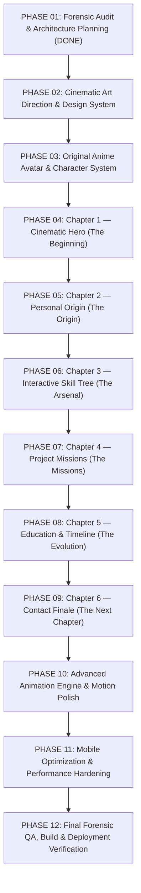

# IMPLEMENTATION ROADMAP & RISK MITIGATION SPECIFICATION
**Project**: SANTHOSH KUMAR M | THE DEVELOPER CHRONICLES  
**Phase**: Prompt 01 — Implementation Roadmap & Risk Analysis  
**Date**: November 2026  
**Author**: Principal Frontend Architect & Production Release Manager  

---

## 1. 12-Phase Sequential Execution Roadmap

To ensure zero downtime, prevent architectural drift, and maintain high code quality, development is strictly staged into twelve sequential phases. Each phase must compile cleanly and pass validation before the next begins.

---

## 2. Phase Breakdown & Success Criteria

| Phase | Phase Name | Core Deliverables | Verification Gate |
| :---: | :--- | :--- | :--- |
| **01** | **Forensic Audit & Architecture** | `PORTFOLIO_FORENSIC_AUDIT.md`, `STORY_ARCHITECTURE.md`, `ASSET_INVENTORY.md`, `IMPLEMENTATION_ROADMAP.md` | All 4 docs created; existing build intact with 0 errors. |
| **02** | **Cinematic Design System** | `VISUAL_DESIGN_SYSTEM.md`, `CHARACTER_STYLE_GUIDE.md`, `SCENE_ASSET_SPECIFICATION.md`, token updates. | Tokens compile; dark palette & typography validated. |
| **03** | **Anime Avatar System** | `AnimeAvatar.tsx`, 6 character states (`idle`, `thinking`, `coding`, `achievement`, `exploring`, `future`). | Avatar loads smoothly with SVG fallbacks; no layout shift. |
| **04** | **Chapter 1: The Beginning** | `CinematicHero.tsx`, opening parallax, responsive typography, CTA buttons. | Hero renders at 60 FPS across desktop & mobile. |
| **05** | **Chapter 2: The Origin** | `AboutSection.tsx` refactored as Chapter 2, personal photo & anime character integration. | Narrative verified against Gnanamani College records. |
| **06** | **Chapter 3: The Arsenal** | `SkillTree.tsx`, `SkillNode.tsx`, `SkillConnections.tsx`, 7 skill categories. | Interactive SVG path glowing; keyboard accessible. |
| **07** | **Chapter 4: The Missions** | `MissionScene.tsx`, showcase for LorryBook/RDA, NexusATS, Recall AI, and Security Scripts. | Accurate engineering details; working repository links. |
| **08** | **Chapter 5: The Evolution** | `StoryTimeline.tsx`, vertical cybernetic progress line, educational achievements. | Progression draws smoothly on scroll without lag. |
| **09** | **Chapter 6: The Next Chapter** | `ContactFinale.tsx`, futuristic horizon scene, email copy & social links. | All links verified; no simulated contact form submission. |
| **10** | **Animation Engine Polish** | GSAP ScrollTrigger + Framer Motion choreography, memory cleanup hooks. | Zero memory leaks; unmounted listeners killed cleanly. |
| **11** | **Mobile & Performance** | Touch optimization, viewport tests (360px–1920px), responsive image sizing. | Core Web Vitals green; smooth on i5-1334U hardware. |
| **12** | **Final QA & Deployment** | Final audit report, production build, GitHub Pages & Vercel readiness. | Dual deployment verified; live URL returns 200 OK. |

---

## 3. Explicit Risk Analysis & Mitigation Strategies

### Risk 1: Animation Performance Degradation on Mid-Range Laptops & Mobile
- **Threat**: The target user machine is an Intel Core i5-1334U with 16 GB RAM and integrated Intel Iris Xe graphics. Excessive concurrent canvas re-renders, uncontrolled particle loops, or non-GPU accelerated CSS animations can cause dropped frames and thermal throttling.
- **Mitigation**:
  - Restrict animations strictly to composite-only properties (`transform: translate3d(...)` and `opacity`).
  - Use `IntersectionObserver` to freeze animations when sections are out of the viewport.
  - Limit particle systems to max 25 particles on desktop, 10 on tablet, and 0 on mobile.
  - Honor `prefers-reduced-motion: reduce` completely.

### Risk 2: Character Consistency Drift
- **Threat**: Introducing anime character assets from disparate sources could make the portfolio look like different artists randomly assembled the site.
- **Mitigation**:
  - Establish a single `CHARACTER_STYLE_GUIDE.md` in Phase 02 with strict palette anchors, silhouette outlines, clothing details, and line-weight standards.
  - Require all 6 poses to share identical color codes (e.g., `#0A0B09` dark cyber-jacket, `#C7FF45` lime collar accent, consistent dark hair style).

### Risk 3: Credibility Loss with Engineering Recruiters
- **Threat**: Overemphasizing anime visuals at the expense of real engineering evidence could make the portfolio appear frivolous or unprofessional to senior engineering hiring managers.
- **Mitigation**:
  - Anchor every single project in verified GitHub repositories, actual problem statements, and real code architecture.
  - Keep the authentic formal portrait of Santhosh Kumar M prominent and accessible in the Hero and About chapters.
  - Preserve the ATS-compliant resume generator and print engine.

### Risk 4: Dual Deployment Routing Drift
- **Threat**: Changes to build output paths could break GitHub Pages branch deployment or Vercel routing.
- **Mitigation**:
  - Maintain the automated `scripts/sync-dist.cjs` pipeline so that every production build automatically updates both `dist/` and root `index.html` + `assets/`.
  - Maintain `.nojekyll` and `404.html` in both `public/` and the repository root.

---

## 4. Phase 01 Sign-Off & Handoff to Phase 02

- **Audit Completion**: All 98 source files, 33 components, 14 SVGs, and 15 data models have been inventoried.
- **Documentation Deliverables Created**:
  1. [`docs/PORTFOLIO_FORENSIC_AUDIT.md`](file:///D:/portfolio/portfolio-main/docs/PORTFOLIO_FORENSIC_AUDIT.md)
  2. [`docs/STORY_ARCHITECTURE.md`](file:///D:/portfolio/portfolio-main/docs/STORY_ARCHITECTURE.md)
  3. [`docs/ASSET_INVENTORY.md`](file:///D:/portfolio/portfolio-main/docs/ASSET_INVENTORY.md)
  4. [`docs/IMPLEMENTATION_ROADMAP.md`](file:///D:/portfolio/portfolio-main/docs/IMPLEMENTATION_ROADMAP.md)
- **Current Production Build**: Verified clean with `npx tsc --noEmit` and `npm run build` exiting with code 0.
- **Status**: Ready to proceed to **Prompt 02: Creative Direction & Cinematic Design System** upon user confirmation.

