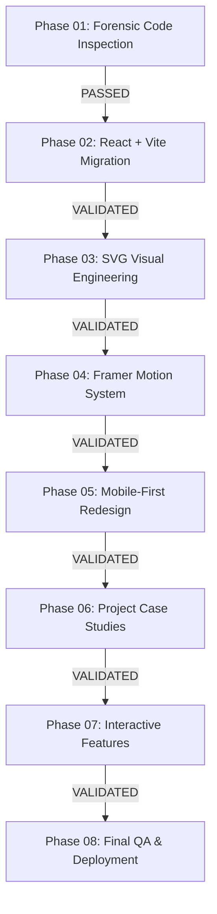

# Portfolio V3: Sequential Migration Plan & Risk Register

**Status**: Ready for Prompt 02 Execution  
**Strategy**: Incremental, evidence-based migration. Each phase must finish and pass its checks before advancing.

---

## 1. Sequential Phase Roadmap

### Phase 01: Forensic Inspection (Completed)
- Complete directory topography, dependency audit, duplicate detection, and feature inventory.
- Output artifacts:
  - `docs/V3_MIGRATION_AUDIT.md`
  - `docs/FEATURE_INVENTORY.md`
  - `docs/MIGRATION_PLAN.md`

### Phase 02: React + Vite + TypeScript Migration (Next Phase)
- Initialize clean component architecture:
  - `Navbar.tsx`, `MobileNavigation.tsx`, `HeroSection.tsx`, `SystemVisualization.tsx`, `ProjectCard.tsx`, `ProjectSchematic.tsx`, `AboutSection.tsx`, `SkillsSection.tsx`, `ExperienceTimeline.tsx`, `EngineeringProcess.tsx`, `AIEngineeringSection.tsx`, `ContactSection.tsx`, `Footer.tsx`, `ScrollProgress.tsx`.
- Configure `vite.config.ts` with `base: '/portfolio/'`.
- Strict TypeScript type safety without `any` overrides.
- Execute clean `npm run build` and eliminate any compiler errors.

### Phase 03: Advanced SVG Visual System
- Package 9 custom inline SVGs into isolated components.
- Ensure responsive `viewBox` coordinates without clipping.
- Verify `currentColor` and CSS token inheritance.
- Provide `<title>` and `<desc>` on every diagram for screen-reader accessibility.
- Label all conceptual schemas with `[CONCEPTUAL SCHEMA]`.

### Phase 04: Framer Motion Animation Engine
- Implement purposeful typography reveals, scroll reveals with `whileInView`, and data packet animation.
- Restrict continuous animation loops strictly to active viewports via IntersectionObserver.
- Enforce comprehensive `prefers-reduced-motion` fallbacks using `useReducedMotion()`.

### Phase 05: Mobile-First Responsive Redesign
- Validate every section across target viewports:
  `320px`, `360px`, `375px`, `390px`, `430px`, `768px`, `1024px`, `1440px`, and `1920px`.
- Guarantee zero horizontal scrollbar overflow.
- Maintain touch target dimensions $\ge 44\text{px} \times 44\text{px}$ on all interactive controls.

### Phase 06: Professional Project Case Studies
- Present all 6 case studies with clear problem statements, solutions, technologies used, and evidence status.
- Avoid fabricated live demo links or unverified claims.

### Phase 07: Interactive Portfolio Upgrades
- Provide interactive node selection in the system visualization.
- Ensure simulated in-browser assistant maintains explicit simulation disclaimers.

### Phase 08: Final Production Audit & GitHub Pages Deployment
- Run full type-check (`tsc`), linting, and production build (`vite build`).
- Verify asset paths relative to `/portfolio/`.
- Validate local HTTP server response.
- Update GitHub Actions workflow `.github/workflows/deploy-pages.yml`.

---

## 2. Explicit Risk Register & Mitigation Strategy

| Risk ID | Description | Severity | Mitigation Strategy |
| :--- | :--- | :--- | :--- |
| **RSK-01** | **GitHub Pages Base Path 404** Vite assets default to root `/assets/...` instead of `/portfolio/assets/...`, breaking scripts and styles on deployment. | **CRITICAL** | Set `base: '/portfolio/'` explicitly in `vite.config.ts` and verify build output in `dist/index.html`. |
| **RSK-02** | **Accidental Content Loss** Original verified education, GPA (7.2/10), and Cybernaut/ELITA internships omitted during componentization. | **HIGH** | Centralize verified data in strongly typed modules (`src/data/experience.ts`, `src/data/projects.ts`, `src/data/skills.ts`) cross-referenced against `AUDIT.md`. |
| **RSK-03** | **Misleading AI Claims** Simulated in-browser assistant mistaken for real live model inference by recruiters. | **HIGH** | Display permanent simulation badges: `[IN-BROWSER DEMO SIMULATION ONLY: No external LLM inference, zero data leakage]`. |
| **RSK-04** | **Mobile Horizontal Overflow** Wide SVG schematics or monospace labels causing page horizontal shaking on small mobile screens (320px–375px). | **HIGH** | Enforce `w-full h-auto` on all SVG viewports, apply `overflow-hidden` on parent containers, and test 320px viewport directly. |
| **RSK-05** | **CPU Thrashing from Infinite Loops** SVG packet animations running continuously when elements are scrolled out of viewport. | **MEDIUM** | Use Framer Motion's `whileInView` and `useReducedMotion()` to pause animation when offscreen or when reduced motion is preferred. |
| **RSK-06** | **Unused Import TypeScript Failures** Strict mode (`noUnusedLocals: true`) aborts production build on stray icon imports. | **MEDIUM** | Run `tsc --noEmit` locally and clean all imports prior to concluding any phase. |

---

## 3. Definition of Done (DoD) for Prompt 01

- [x] Directory structure and entry points inspected.
- [x] All technologies and dependencies cataloged.
- [x] Existing features, canvas, SVGs, and animations inventoried.
- [x] Real credentials distinguished from prototypes and simulations.
- [x] `docs/V3_MIGRATION_AUDIT.md` created.
- [x] `docs/FEATURE_INVENTORY.md` created.
- [x] `docs/MIGRATION_PLAN.md` created.
- [x] Zero application code broken during Prompt 01 inspection.
- [x] Baseline verified safe for Prompt 02.

