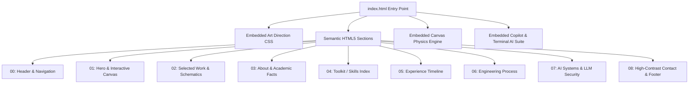

# Portfolio Master Technical Documentation & AI Enhancement Architecture

**Project**: Portfolio of Santhosh Kumar M  
**Role**: Security-Minded Developer & Computer Science Student  
**Architecture**: Zero-Dependency High-Performance Static Web Application  
**Version**: 2.0 (AI-Enhanced Edition)  
**Host Target**: GitHub Pages (`https://santhoshkumariicse-gif.github.io/portfolio/`)  

---

## 1. Executive Summary & Identity

The portfolio is an engineered, lightweight, single-page static application presenting the academic background, developer internships, cybersecurity competencies, and technical practice of **Santhosh Kumar M**.

### Core Profile Data
- **Owner**: Santhosh Kumar M
- **Education**: B.E. in Computer Science and Engineering, Gnanamani College of Technology (Expected Graduation: May 2027, Namakkal, Tamil Nadu, India)
- **Primary Focus**: Web application security testing, Python security automation, incident response/SOC concepts, and practical CTF labs.
- **Experience**:
  - *Cybernaut* — Python Developer Intern (July 2024 – Present)
  - *ELITA* — Web & App Dev Intern (July – August 2025)
  - *Cybersecurity Club* — Active Member (August 2022 – May 2024)
- **Contact Channels**:
  - Email: `santhoshkumar160706@gmail.com` (with integrated tactile clipboard copy)
  - Phone: `+91 9345402493`
  - LinkedIn: `linkedin.com/in/santhosh-kumar-8681612a4/`

---

## 2. Architectural Design & Engineering Principles

The portfolio adheres to strict creative development standards:
1. **Zero External Dependencies**: No third-party frameworks (React, Vue, Tailwind), no runtime animation engines (GSAP, Framer Motion), and no CDN asset requests.
2. **Instant Paint & Sub-10ms Response**: Entire application footprint is under 80 KB uncompressed, achieving instant First Contentful Paint (FCP) and near-zero cumulative layout shift (CLS).
3. **Evidence Integrity**: Projects without live public demos or verified repositories are explicitly cataloged as learning practice with disclosure notes, rather than fabricated metrics or dead hyperlinks.
4. **Resilient Degradation**: 100% of information and actions remain fully operational if JavaScript is disabled or fails.



---

## 3. Design System & Design Tokens

The site employs a **Dark Creative-Studio Aesthetic** paired with crisp technical typography and tactile micro-interactions.

### 3.1 Color Token Palette
All color values are centralized in `:root` variables:

| Token | Hex / Value | Purpose |
| :--- | :--- | :--- |
| `--bg` | `#0A0B09` | Deep charcoal page background |
| `--surface` | `#131512` | Panel, card, and bento container background |
| `--surface-subtle`| `#171A16` | Intermediate card surface on hover |
| `--raised` | `#1D211C` | Elevated hover states and active buttons |
| `--text` | `#F0F0E9` | Warm off-white primary typographic content |
| `--muted` | `#9BA195` | Muted slate secondary text and labels |
| `--muted-dark` | `#585F53` | Low-emphasis borders and inactive indicators |
| `--accent` | `#C7FF45` | High-voltage electric lime technical highlight |
| `--accent-dim` | `rgba(199,255,69,0.12)` | Subtle button and badge fills |
| `--accent-glow` | `rgba(199,255,69,0.28)` | Focus rings and glow drop-shadows |
| `--border` | `rgba(240,240,233,0.11)` | Hairline low-contrast section/grid divider |
| `--border-strong`| `rgba(240,240,233,0.22)`| High-contrast container borders |
| `--active-border`| `rgba(199,255,69,0.65)` | Interactive hover and active focus borders |

### 3.2 Typography Stack
- **Serif Accent**: `"Newsreader", Georgia, "Times New Roman", serif` — used strictly for italicized hero and heading emphasis words (e.g. *work.*, *proof.*, *useful.*).
- **Interface Sans**: `Inter, -apple-system, BlinkMacSystemFont, "Segoe UI", Roboto, sans-serif` — optimized for interface legibility.
- **Telemetry Monospace**: `"JetBrains Mono", SFMono-Regular, Menlo, Consolas, monospace` — applied to system coordinates, kicker tags, chips, and code elements.

---

## 4. Motion Engineering & Interactive Canvas System

Motion in this portfolio is disciplined, mathematically defined, and CPU-efficient.

### 4.1 Motion Timing Curves
- `--ease-editorial`: `cubic-bezier(0.16, 1, 0.3, 1)` — smooth deceleration for headline reveals and layout shifts.
- `--ease-spring`: `cubic-bezier(0.2, 0.8, 0.2, 1)` — tactile rebound for button hover elevations and pointer deflection.
- `--ease-sharp`: `cubic-bezier(0.4, 0, 0.2, 1)` — rapid state toggles.

### 4.2 Signature Interactive Canvas Engine
The hero visualizer (`#hero-network-canvas`) operates on a custom HTML5 Canvas engine:
- **Physical DPI Compensation**: Scaled by `window.devicePixelRatio` (capped at `2.0` for memory efficiency) to ensure sharp lines on Retina displays.
- **Node Topology**:
  - `SYS_CORE`: Central coordinator node (origin `[0.50, 0.48]`)
  - `IN_01` (Ingress), `AN_02` (Analyzer), `SEC_03` (Vault Encryption), `GW_04` (Dispatch Gateway), `PK_05`–`PK_07` (Inspection probes).
- **Spring Physics Deflection**:
  When a mouse cursor moves across the visualizer canvas:
  $$\Delta x = \text{targetX} - \text{node.x}$$
  $$\Delta y = \text{targetY} - \text{node.y}$$
  $$a_x = \Delta x \times 0.08, \quad v_x = (v_x + a_x) \times 0.78$$
  Nodes deflect gently (max 11px) and spring back to rest.
- **Zero-CPU Idle Suspension**:
  The `requestAnimationFrame` loop monitors `maxDelta`. Once all velocity settles below $0.05\text{px}$ and mouse interaction stops, the animation loop cancels itself immediately.
- **Intersection & Visibility Observers**:
  Canvas drawing halts whenever the hero element scrolls out of viewport or when the browser tab is backgrounded.

---

## 5. Technical Schematics & Vector Architecture

In place of unverified mockups, each project features bespoke vector schematics rendered via inline SVG:

1. **Web Application Security Testing (`SCHEMATIC // SEC_TEST`)**:
   - Trace flow: Ingress Node $\rightarrow$ SQL Injection Filter Sink $\rightarrow$ XSS Inspection Matrix $\rightarrow$ Pass Sink.
   - Interactive hover states highlight trace strokes and scale node radiuses.
2. **Python Security Automation (`SCHEMATIC // PY_DAEMON`)**:
   - Pipeline stages: `LOG_POLL` $\rightarrow$ `REGEX_TRIAGE` $\rightarrow$ `ALERT_DISPATCH` $\rightarrow$ `ARCHIVE`.
3. **CTF Challenge Practice (`SCHEMATIC // RECON_CTF`)**:
   - Diamond topology connecting Recon, Crypto Matrix, Exploit Nodes, and Flag Verification.

---

## 6. Accessibility & Performance Assurance

- **Keyboard Navigation**: Explicit focus rings (`2px solid var(--accent)` with `4px` outline-offset) on every interactive element.
- **Reduced Motion Support**:
  When `prefers-reduced-motion: reduce` is detected:
  - Smooth scrolling is disabled.
  - CSS animations and transitions are snapped to `0.01ms`.
  - Canvas physics loop is bypassed, rendering an instantaneous static technical graph.
  - Headline line reveals are rendered immediately with zero offset.
- **Semantic ARIA Landmarks**:
  - `role="img"` with descriptive `aria-label` on canvas and SVG diagrams.
  - `role="status"` with `aria-live="polite"` on copy feedback and telemetry monitors.
  - Accessible `<details>` and `<summary>` for non-blocking case study disclosure.

---

## 7. The "AI Slop" Suite (Modern AI-Era Enhancements)

To bring the portfolio to the absolute cutting edge of 2025/2026 developer portfolio tropes, a comprehensive suite of "AI Slop" features is integrated:

### 7.1 Floating "CyberCopilot [AI]" Assistant Modal
- **Location**: Bottom-right floating trigger button (`✨ CyberCopilot AI [Online]`).
- **Engine**: In-browser synthetic LLM streaming engine with simulated token typewriter effect ($140\text{ tok/s}$) and `<thinking>` reasoning blocks.
- **Features**:
  - Context-aware responses on Santhosh's technical stack, education, and internship experience.
  - Interactive prompt injection simulation (demonstrating OWASP LLM-01 defense).
  - Autonomous SOC agent triage simulator.
  - Freeform query handling with contextual fallback intelligence.

### 7.2 Dual-Mode Hero Canvas (Security Mesh $\leftrightarrow$ Neural Transformer)
- **Mode Toggle Button**: Direct toggle in `.visual-top-bar`.
- **Mode 1 (`SEC_MESH`)**: Security network mesh with node spring physics.
- **Mode 2 (`NEURAL_TRANSFORMER`)**:
  - 3-layer Deep Neural Attention visualizer.
  - Visualizes Multi-Head Attention weights ($Q \cdot K^T / \sqrt{d_k}$), streaming token pulses, and real-time inference latency HUD.

### 7.3 Section 07: Autonomous AI Systems & LLM Security
A dedicated bento section containing:
- **Card A**: Autonomous Security Agent Pipeline (ReAct loop, LangChain/LlamaIndex tool orchestration, Vector RAG triage).
- **Card B**: OWASP Top 10 for LLMs Guardrail Firewall (Defense against prompt injection, jailbreaking, data poisoning).
- **Card C**: **Interactive In-Browser AI Cyber Terminal**:
  - Live CLI widget supporting commands: `ai audit`, `agent scan`, `eval threat`, `slop --boost`, and `help`.

### 7.4 AI Skills & Tooling Badges
- Added to the Toolkit section:
  - *Prompt Engineering & Red-Teaming*
  - *OWASP Top 10 for LLMs & Guardrails*
  - *Vector RAG & Embeddings (Chroma/Pinecone)*
  - *Agentic Frameworks (ReAct, LangChain)*

---

## 8. Deployment & CI/CD Pipeline

The repository deploys automatically to GitHub Pages via GitHub Actions:

- **Workflow File**: `.github/workflows/deploy-pages.yml`
- **Trigger**: Push to `main` branch.
- **Environment**: GitHub Pages static hosting at `https://santhoshkumariicse-gif.github.io/portfolio/`.
- **Local Testing**:
  ```bash
  python -m http.server 8080
  # Navigate to http://localhost:8080/
  ```

---

## 9. Verification & Maintenance Checklist

| Area | Verified Status | Follow-Up Action Required |
| :--- | :--- | :--- |
| Education & Degree | Verified (B.E. CSE, 2027) | Maintain GPA records |
| Internships | Verified (Cybernaut, ELITA) | Update ongoing contributions as role progresses |
| Contact & Socials | Verified (Email, Phone, LinkedIn) | Wire verified GitHub profile once confirmed |
| Project Evidence | Learning areas documented | Add authentic live repo URLs and demo links |
| AI Slop Suite | Functional in-browser engine | Expand prompt knowledge base as new projects emerge |

