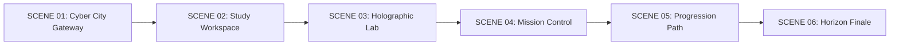

# SCENE ASSET SPECIFICATION: THE SIX STORY CHAPTERS
**Project**: SANTHOSH KUMAR M | THE DEVELOPER CHRONICLES  
**Phase**: Prompt 02 — Scene Asset Specification & Environmental Staging  
**Date**: November 2026  
**Author**: Lead Environment Designer & Technical Asset Director  

---

## 1. Environmental Worldbuilding Overview

The six narrative environments form a continuous visual journey through Santhosh Kumar M's developer odyssey. Each scene maintains identical lighting anchors (deep obsidian ground planes, volumetric twilight gradients, neon lime bus lines, and subtle HUD coordinate reticles), creating the cohesive feeling of one interconnected universe.



---

## 2. Detailed Scene Specifications

### Scene 01: Cyber City Opening (The Beginning)
- **Narrative Setting**: High-elevation observation desk in a futuristic tech city at dusk. Massive architectural spires with pulsing data fibers in the background.
- **Atmospheric Palette**: Dark charcoal `#0A0B09`, deep navy slate `#0E121A`, electric lime `#C7FF45` grid traces.
- **Desktop Dimensions**: `1920 × 1080` (Optimized WebP, target `< 160 kB`).
- **Mobile Composition**: `1080 × 1920` (Vertical crop emphasizing the high spires and central command console).
- **Foreground Elements**: Glass terminal console, interactive coordinate reticle, status beacon `ONLINE // CS ENG`.
- **Avatar Pose**: `idle` (standing beside the central viewport).

### Scene 02: Personal Study & Development Workspace (The Origin)
- **Narrative Setting**: An organized developer workshop inside an engineering laboratory. Dual glowing curved monitors display terminal logs, code editors, and architecture schematics.
- **Atmospheric Palette**: Warm charcoal `#131512`, soft amber backlight `rgba(255, 180, 80, 0.08)`, lime editor highlight.
- **Desktop Dimensions**: `1920 × 1080` (Optimized WebP, target `< 150 kB`).
- **Mobile Composition**: Focuses on desk surface, terminal shell, and personal identity plaque.
- **Foreground Elements**: Gnanamani College of Technology engineering handbook, terminal monitor, coffee mug with code logo.
- **Avatar Pose**: `thinking` (analyzing code on the monitor).

### Scene 03: Holographic Skill Laboratory (The Arsenal)
- **Narrative Setting**: Circular holographic training chamber. Glowing cyan and lime vector paths suspended in mid-air represent skill nodes and interconnecting technologies.
- **Atmospheric Palette**: Obsidian `#0A0B09`, cyan luminescence `#00E5FF`, cyber lime `#C7FF45`.
- **Desktop Dimensions**: `1920 × 1080` (Optimized WebP / interactive SVG canvas).
- **Mobile Composition**: Vertical node waterfall hierarchy keeping touch targets `≥ 44px`.
- **Foreground Elements**: 7 interactive skill nodes, glowing SVG bus lines, dynamic ability stat card.
- **Avatar Pose**: `exploring` (touching holographic skill nodes).

### Scene 04: Software Engineering Mission Control (The Missions)
- **Narrative Setting**: Heavy mission operations bridge. Tactical wall displays show route telemetry (RDA/LorryBook), resume parsing pipelines (NexusATS), and vector embeddings (Recall AI).
- **Atmospheric Palette**: Dark steel `#121511`, mission crimson beacon `#FF3358`, cyber lime `#C7FF45`.
- **Desktop Dimensions**: `1920 × 1080` (Target `< 165 kB`).
- **Mobile Composition**: Stacked mission cards with tactical HUD borders and direct GitHub repository links.
- **Foreground Elements**: Pinned mission cards, architecture schematics, interactive execution button.
- **Avatar Pose**: `coding` (working at mission dispatch keyboard).

### Scene 05: Academic & Milestone Progression (The Evolution)
- **Narrative Setting**: Ascending glass sky-walkway with glowing timeline node rings tracking academic years and internship milestones.
- **Atmospheric Palette**: Deep obsidian `#0A0B09`, subtle emerald/lime gradient, starfield dust.
- **Desktop Dimensions**: `1920 × 1080` (Target `< 140 kB`).
- **Mobile Composition**: Streamlined vertical SVG cyber-path with step-by-step milestone cards.
- **Foreground Elements**: SVG progressive timeline path, expandable milestone cards, GPA 7.2/10 credential badge.
- **Avatar Pose**: `achievement` (celebrating project delivery).

### Scene 06: Futuristic City Horizon Finale (The Next Chapter)
- **Narrative Setting**: Open-air panoramic balcony overlooking the expansive illuminated tech city skyline under a clear starlit sky.
- **Atmospheric Palette**: Twilight indigo `#0B0D14`, obsidian `#0A0B09`, lime accents `#C7FF45`.
- **Desktop Dimensions**: `1920 × 1080` (Target `< 150 kB`).
- **Mobile Composition**: Horizon skyline at top, contact CTAs and verified social links anchored below.
- **Foreground Elements**: Direct email copy button, LinkedIn & GitHub gateway pills, ATS resume download trigger.
- **Avatar Pose**: `future` (looking out toward the horizon).

---

## 3. Asset Format, Dimensional Budget & Performance Targets

| Asset Category | Target Format | Max File Size | Desktop Resolution | Mobile Resolution | Loading Priority |
| :--- | :--- | :--- | :--- | :--- | :--- |
| **Scene Backgrounds** | `.webp` / `.svg` | `< 160 kB` | `1920 × 1080` | `1080 × 1920` | Lazy loaded (except Hero: Eager) |
| **Avatar Expressions** | `.webp` + SVG | `< 75 kB` | `768 × 1024` | `480 × 640` | Scene 01 Eager; others Lazy |
| **HUD Reticles** | Pure Inline SVG | `< 3 kB` | Vector Scalable | Vector Scalable | Inline in DOM |
| **Tech Icons** | Pure Inline SVG | `< 2 kB` | Vector Scalable | Vector Scalable | Inline in DOM |
| **Real Photo Asset** | `.jpg` (Preserved) | `105 kB` | `768 × 1024` | `480 × 640` | Eager in Hero & About |

---

## 4. Asset Directory Organization

```
public/images/
├── avatar/
│   ├── avatar-idle.webp
│   ├── avatar-thinking.webp
│   ├── avatar-coding.webp
│   ├── avatar-achievement.webp
│   ├── avatar-exploring.webp
│   └── avatar-future.webp
├── scenes/
│   ├── scene-01-beginning.webp
│   ├── scene-02-origin.webp
│   ├── scene-03-arsenal.webp
│   ├── scene-04-missions.webp
│   ├── scene-05-evolution.webp
│   └── scene-06-finale.webp
├── decorations/
│   ├── hud-frame.svg
│   ├── reticle-corner.svg
│   └── telemetry-grid.svg
└── santhosh-kumar.jpg (Authentic Photo)
```

