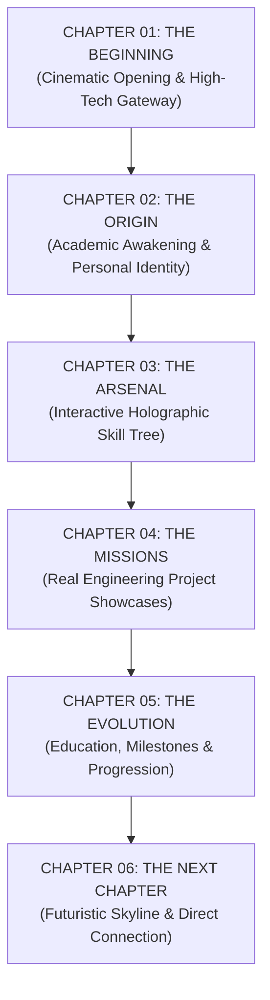

# STORY ARCHITECTURE SPECIFICATION
**Project**: SANTHOSH KUMAR M | THE DEVELOPER CHRONICLES  
**Phase**: Prompt 01 — Story & Experience Architecture  
**Date**: November 2026  
**Author**: Principal Creative Architect & Lead Experience Designer  

---

## 1. Narrative Concept: "THE DEVELOPER CHRONICLES"

"THE DEVELOPER CHRONICLES" transforms the portfolio from a standard list of skills and projects into an episodic visual narrative. The visitor follows the journey of **Santhosh Kumar M**, a dedicated Computer Science Engineering student and aspiring developer, advancing through challenging engineering missions, mastering abilities in high-tech laboratories, and building practical digital solutions.

The experience is structured as **Six Connected Story Chapters**:



---

## 2. The Six Narrative Chapters

### Chapter 01: THE BEGINNING (Cinematic Hero)
- **Narrative Logline**: "Every great solution begins with a problem worth solving."
- **Visual Setting**: High-tech command console overlooking a futuristic technological metropolis at twilight. Ambient neon circuit paths trace across the glass floor.
- **Character State**: Anime Developer Avatar enters the workstation scene (`expression="idle"`); observant, focused, and ready.
- **Visitor Objective**: Immediate first impression establishing Santhosh's identity as a Computer Science Engineering student at Gnanamani College of Technology.
- **Key Actions**: Explore Projects, Download Resume, Contact Me, GitHub / LinkedIn gateways, and interactive toggle to view the authentic professional photograph.

### Chapter 02: THE ORIGIN (Personal Story & Philosophy)
- **Narrative Logline**: "Curious by default. Disciplined by design."
- **Visual Setting**: Personal development workshop with dual holographic monitors, running terminal shells, and software architecture schematics.
- **Character State**: Avatar at the desk (`expression="thinking"`), analyzing system blueprints.
- **Narrative Content**:
  - Educational background at Gnanamani College of Technology (B.E. CSE, 2023–2027, GPA 7.2/10).
  - Genuine passion for practical software engineering (full-stack web platforms and Android apps).
  - Experience in AI-assisted development and emerging technology exploration.
  - Core philosophy: First-principles problem decomposition, clean code, and defensive security.
- **Visual Integration**: Side-by-side presentation of the anime developer character and the verified formal portrait photograph.

### Chapter 03: THE ARSENAL (Interactive Skill Tree)
- **Narrative Logline**: "Every tool is an ability. Every project is an opportunity to improve."
- **Visual Setting**: Holographic ability chamber with glowing SVG vectors connecting technology nodes.
- **Character State**: Avatar manipulating holographic interface nodes (`expression="exploring"`).
- **The 7 Ability Domains**:
  1. *Programming Languages* (Python, Java, JavaScript, TypeScript, C/C++)
  2. *Frontend Development* (React, Tailwind CSS, Modern CSS3, HTML5, Responsive UI/UX)
  3. *Backend Development* (Node.js, Express, FastAPI, Flask, REST APIs)
  4. *Mobile Application Development* (Android, Java/Kotlin basics, XML Layouts)
  5. *Databases & Data Modeling* (PostgreSQL, MySQL, SQLite, MongoDB)
  6. *Development Tools & DevOps* (Git, GitHub, Linux CLI, Postman, CI/CD)
  7. *AI & Emerging Technologies* (AI-Assisted Development, OpenAI API, Prompt Defense, OWASP Top 10)
- **Interactive Mechanics**: Hovering or tapping a node highlights connected ability paths, opens a tactical telemetry card, and triggers avatar visual reactions.

### Chapter 04: THE MISSIONS (Cinematic Project Showcase)
- **Narrative Logline**: "Real problems. Real engineering. Real solutions."
- **Visual Setting**: Engineering mission control room with telemetry displays dedicated to four primary operational missions.
- **Character State**: Avatar actively deploying code (`expression="coding"`).
- **The Missions**:
  - **Mission 01: LorryBook / RDA** — On-demand freight and driver allocation platform with geofenced routing and proof-of-delivery reconciliation.
  - **Mission 02: NexusATS** — Automated recruitment pipeline with structured resume parsing and bias-free blind screening.
  - **Mission 03: Recall AI** — Hackathon contextual knowledge assistant using semantic chunking and vector embeddings.
  - **Mission 04: Security Automation Tooling** — Python log triage daemon built during Cybernaut internship.
- **Presentation Standards**: Actual problem space, engineering architecture, tech stack chips, personal contributions, and repository links. Zero fabricated statistics or fake screenshots.

### Chapter 05: THE EVOLUTION (Education & Progression)
- **Narrative Logline**: "Knowledge compounded through consistent execution."
- **Visual Setting**: Upward-winding cybernetic timeline path connecting academic and practical milestones.
- **Character State**: Avatar celebrating key milestones (`expression="achievement"`).
- **Progression Milestones**:
  - *Gnanamani College of Technology*: B.E. Computer Science and Engineering (2023–2027).
  - *Cybernaut Technologies*: Python Developer Intern (Jul 2024–Present).
  - *ELITA*: Web & App Development Intern (Jul–Aug 2025).
  - *GCT Cybersecurity Club*: Core member and peer lab workshop facilitator (2022–2024).
  - *PortSwigger Web Security Labs*: Practical OWASP Top 10 mitigation study.
- **Visual Interaction**: SVG timeline path illuminates progressively as the visitor scrolls, unveiling expandable milestone cards.

### Chapter 06: THE NEXT CHAPTER (Contact & Future Horizon)
- **Narrative Logline**: "Every project is another chapter. Let's build something meaningful."
- **Visual Setting**: Wide panoramic observation deck looking outward toward an illuminated tech city horizon.
- **Character State**: Avatar looking forward toward the future skyline (`expression="future"`).
- **Recruiter Engagement**: Direct email copy interaction, verified GitHub & LinkedIn profile links, downloadable ATS resume, and clear availability statement for internship opportunities.

---

## 3. Reusable Component Architecture

To maintain high maintainability, low bundle overhead, and clean separation of concerns, the following 11 core components will be engineered:

```
src/storytelling/
├── AnimeAvatar.tsx          # Multi-expression original anime developer character
├── StoryChapter.tsx         # Section wrapper with cinematic scene staging & scroll hooks
├── CinematicHero.tsx        # Layered parallax hero environment
├── CharacterDialogue.tsx    # Dynamic speech bubble & narrator HUD
├── SkillTree.tsx            # Connected SVG ability graph
├── SkillNode.tsx            # Individual interactive ability node
├── SkillConnections.tsx     # Animated SVG connecting lines
├── MissionScene.tsx         # Pinned/horizontal project mission showcase
├── ProjectEnvironment.tsx   # Atmospheric background canvas per project
├── StoryTimeline.tsx        # Progressively drawn SVG cyber-timeline
└── ChapterNavigation.tsx    # Floating cinematic chapter dock & jump index
```

### Component Interfaces (TypeScript)

#### 1. `AnimeAvatar.tsx`
```typescript
export type AvatarExpression = 
  | 'idle' 
  | 'thinking' 
  | 'coding' 
  | 'achievement' 
  | 'exploring' 
  | 'future';

export interface AnimeAvatarProps {
  expression: AvatarExpression;
  size?: 'sm' | 'md' | 'lg' | 'xl';
  scene?: string;
  interactionEnabled?: boolean;
  animationEnabled?: boolean;
  className?: string;
  onPoseChange?: (expression: AvatarExpression) => void;
}
```

#### 2. `StoryChapter.tsx`
```typescript
export interface StoryChapterProps {
  chapterNumber: string;
  title: string;
  subtitle: string;
  narrativeLogline: string;
  environmentTheme: 'cyber-city' | 'workspace' | 'hologram-lab' | 'mission-control' | 'timeline' | 'horizon';
  children: React.ReactNode;
}
```

#### 3. `CharacterDialogue.tsx`
```typescript
export interface CharacterDialogueProps {
  speaker: string;
  message: string;
  expression: AvatarExpression;
  position?: 'top-right' | 'top-left' | 'bottom-right';
  autoHideMs?: number;
}
```

#### 4. `MissionScene.tsx`
```typescript
export interface MissionSceneProps {
  missionNumber: string;
  project: ProjectItem;
  isActive: boolean;
  onExploreSchematic?: () => void;
}
```

---

## 4. Animation & Orchestration Standards

1. **Layered Motion Strategy**:
   - **Framer Motion**: Component-level physics, layout morphing (`layoutId`), masked text reveals, and dialog animations.
   - **Scroll Coordination**: Scroll-linked section observers driving chapter transitions and avatar expression changes.
   - **GPU Acceleration**: All environmental animations utilize `transform: translate3d()` and `opacity` with `will-change: transform` only during active transitions.
2. **Accessibility & Reduced Motion**:
   - When `prefers-reduced-motion: reduce` is active, particle systems and continuous camera drifts are disabled; all narrative content is displayed instantly without motion gating.
3. **Hardware Budget Constraint**:
   - Designed to run at 60 FPS on mid-range hardware (e.g., Intel Core i5-1334U with Intel Iris Xe Graphics).

