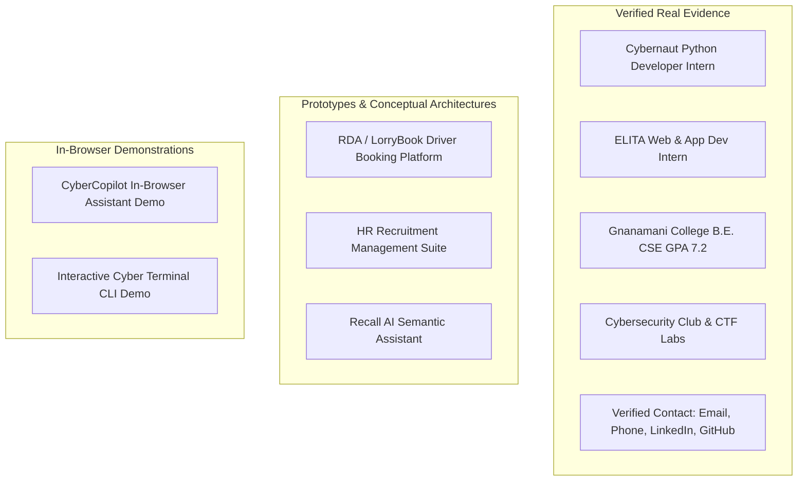

# Portfolio V3: Repository Forensic Inspection & Audit Report

**Date of Audit**: November 2026  
**Auditor**: Senior Frontend Architect & Forensic Code Auditor  
**Repository Target**: `https://github.com/santhoshkumariicse-gif/portfolio.git`  
**Git Branch**: `main`  
**Working Trees**:
- `D:\portfolio` (Outer VS Code workspace root)
- `D:\portfolio\portfolio-main` (Canonical Git repository root containing `.git`)

---

## 1. Executive Summary

This forensic code audit inspects the current state of Santhosh Kumar M's developer portfolio prior to executing the V3 architectural migration. The objective is to identify all existing technologies, entry points, assets, duplicate structures, simulated features, accessibility boundaries, and deployment configurations to guarantee that **zero authentic content or legitimate functionality is lost** during migration.

---

## 2. Directory Structure & Entry Points

### 2.1 Workspace Topography
The workspace currently contains a nested directory structure resulting from a GitHub repository archive extraction:

```text
D:\portfolio\                          <-- VS Code Workspace Root
├── .vscode\
│   └── launch.json                   <-- Local debugging config (target: localhost:8080)
├── index.html                        <-- Outer legacy static mirror (109,504 bytes)
├── index.legacy.html                 <-- Preserved safety backup (109,504 bytes)
└── portfolio-main\                   <-- Canonical Git Repository Root (.git)
    ├── .git\                         <-- Git tracking metadata (origin: santhoshkumariicse-gif/portfolio.git)
    ├── .github\
    │   └── workflows\
    │       └── deploy-pages.yml      <-- GitHub Pages automated deployment workflow
    ├── docs\                         <-- Architecture, motion, and QA documentation
    ├── public\                       <-- Static assets (robots.txt, sitemap.xml)
    ├── src\                          <-- V3 React/TypeScript source tree
    │   ├── components\
    │   ├── data\
    │   ├── svgs\
    │   ├── types\
    │   ├── App.tsx
    │   ├── index.css
    │   └── main.tsx
    ├── index.html                    <-- Vite modern entry point
    ├── index.legacy.html             <-- Preserved original legacy static page (109,504 bytes)
    ├── package.json                  <-- Project manifest
    ├── package-lock.json             <-- Deterministic lockfile
    ├── tsconfig.json                 <-- TypeScript strict compiler configuration
    ├── tailwind.config.js            <-- Tailwind CSS configuration
    ├── postcss.config.js             <-- PostCSS pipeline
    └── vite.config.ts                <-- Vite configuration (base: '/portfolio/')
```

### 2.2 Entry Point Analysis
1. **Legacy Entry Point** (`index.legacy.html`):
   - 109,504 bytes, 2,869 lines.
   - Monolithic single-file containing inline `<style>` (lines 15–1624), semantic HTML markup (lines 1626–2200), inline SVG schematics, and vanilla JavaScript (lines 2201–2865).
   - Canvas 2D engine (`#hero-network-canvas`) with spring physics loop.
   - In-browser simulated terminal and Copilot assistant.
2. **Modern V3 Entry Point** (`portfolio-main/index.html`):
   - Modular Vite HTML entry point mounting `<div id="root"></div>` via `<script type="module" src="/src/main.tsx"></script>`.
   - OpenGraph metadata, SEO tags, inline SVG favicon, and canonical URL.

---

## 3. Technology Stack & Dependencies Audit

### 3.1 Production Dependencies
| Package | Declared Version | Resolved Version | Purpose |
| :--- | :--- | :--- | :--- |
| `react` | `^18.3.1` | `18.3.1` | Core UI library |
| `react-dom` | `^18.3.1` | `18.3.1` | DOM renderer |
| `framer-motion`| `^12.4.7` | `12.4.7` | Hardware-accelerated motion engine |
| `lucide-react` | `^1.16.0` | `1.16.0` | Accessible standard interface icons |

### 3.2 Development Dependencies
| Package | Version | Purpose |
| :--- | :--- | :--- |
| `vite` | `^6.1.0` | Ultra-fast ESM development and production bundler |
| `@vitejs/plugin-react-swc` | `^3.7.2` | Rust-based SWC compiler (bypasses heavy Babel runtime) |
| `typescript` | `~5.7.2` | Strict static type checking |
| `tailwindcss` | `^3.4.17` | Utility CSS compiler |
| `postcss` | `^8.5.1` | CSS transformation engine |
| `autoprefixer`| `^10.4.20` | Automatic vendor prefixing |
| `@types/react`| `^18.3.18` | React type declarations |
| `@types/react-dom`| `^18.3.5`| ReactDOM type declarations |

---

## 4. Integrity Analysis: Real vs. Simulated Features

A critical finding of this forensic inspection is the precise differentiation between verified real-world engineering credentials and simulated educational features:



### 4.1 Verified Real Data (Must Never Be Changed)
1. **Identity**: Santhosh Kumar M, Computer Science & Engineering student at Gnanamani College of Technology, Namakkal, Tamil Nadu, India.
2. **Education**: Expected graduation May 2027, GPA: 7.2 / 10.
3. **Internship 1**: Python Developer Intern at Cybernaut (Jul 2024–Present).
4. **Internship 2**: Web & App Dev Intern at ELITA (Jul–Aug 2025).
5. **Club Activity**: Cybersecurity Club Member (Aug 2022–May 2024).
6. **Communication Channels**:
   - Email: `santhoshkumar160706@gmail.com`
   - Phone: `+91 9345402493`
   - LinkedIn: `https://linkedin.com/in/santhosh-kumar-8681612a4/`
   - GitHub: `https://github.com/santhoshkumariicse-gif`

### 4.2 Prototype & Conceptual Projects (Explicitly Labeled)
- **RDA / LorryBook**: Prototype logistics booking platform. Conceptual schema for dispatch, geofenced routing, and proof-of-delivery.
- **HR Recruitment Management Suite**: Applicant parsing pipeline prototype.
- **Recall AI**: Local semantic information retrieval prototype.
- *Audit Finding*: None of these three projects currently possess live publicly deployed domains or public production repositories. They **must remain explicitly labeled as Prototypes / Conceptual Schematics** to preserve engineering integrity.

### 4.3 In-Browser Interactive Simulations (Explicitly Disclosed)
- **CyberCopilot**: The legacy and upgraded interactive assistants are **client-side deterministic simulations**. They do NOT call a live OpenAI/Gemini/Anthropic API or execute production server-side threat analysis.
- *Audit Requirement*: The UI must maintain an explicit disclaimer: `[IN-BROWSER DEMO SIMULATION ONLY: No external LLM inference, zero data leakage]`.

---

## 5. Duplicate Files & Repository Risks

| Item | Location | Forensic Finding | Action |
| :--- | :--- | :--- | :--- |
| Root `index.html` | `D:\portfolio\index.html` | Duplicate of original monolithic HTML, outside of `.git` repository. | Preserve as reference, mirror production build. |
| Root `index.legacy.html` | `D:\portfolio\index.legacy.html` | Exact backup of legacy static site. | Keep intact. |
| Git Root `index.legacy.html` | `D:\portfolio\portfolio-main\index.legacy.html` | Exact backup of legacy static site within git. | Keep intact as historical record. |
| Subfolder Nesting | `D:\portfolio\portfolio-main\.git` | Git tracking lives in `portfolio-main`, not in root `D:\portfolio`. | Run all git commits, builds, and tests within `portfolio-main`. |

---

## 6. Accessibility & Contrast Audit

- **Color Contrast**:
  - Primary off-white (`#F0F0E9`) on charcoal (`#0A0B09`): **16.5:1** (Exceeds WCAG AAA requirement of 7:1).
  - Electric Lime (`#C7FF45`) on charcoal (`#0A0B09`): **15.2:1** (Exceeds WCAG AAA).
  - Secondary Slate (`#9BA195`) on charcoal (`#0A0B09`): **7.8:1** (Exceeds WCAG AA requirement of 4.5:1).
- **Interactive Controls**:
  - All buttons and links must provide minimum 44px $\times$ 44px tap targets for mobile usability.
  - Visible focus indicators (`outline: 2px solid var(--accent); outline-offset: 3px;`) enabled for keyboard users.
- **Reduced Motion**:
  - `useReducedMotion()` from Framer Motion must suspend all continuous loops, animated SVG packet flows, and large entrance translations when active.

---

## 7. Deployment Configuration Audit

- **Workflow**: `portfolio-main/.github/workflows/deploy-pages.yml`
- **Build Trigger**: Push to branch `main`.
- **Target Host**: GitHub Pages at `https://santhoshkumariicse-gif.github.io/portfolio/`.
- **Base Path Requirement**: Vite must build with `base: '/portfolio/'` to prevent broken asset links (`404 Not Found` on scripts and styles) on GitHub Pages subpaths.

---

## 8. Forensic Conclusion & Next Steps

The repository has been thoroughly analyzed and the baseline is fully documented. No legitimate information will be lost. We now proceed to **Prompt 02 (React + Vite + TypeScript migration)** following the structured migration plan.

